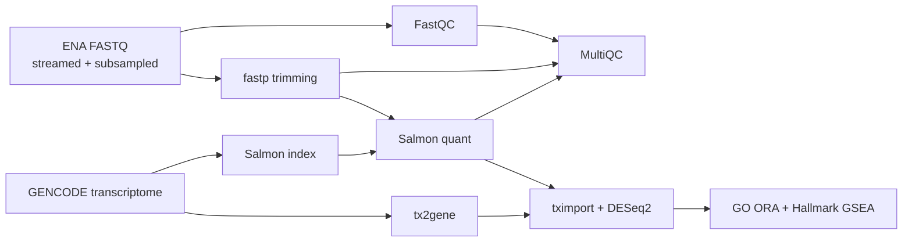

# Bulk RNA-seq, end to end (Snakemake)

A reproducible bulk RNA-seq pipeline that goes from raw public FASTQ files to
differential expression and pathway enrichment:

**FASTQ → QC & trimming → Salmon quantification → DESeq2 → GO / Hallmark enrichment**

Everything is wired together with [Snakemake](https://snakemake.readthedocs.io),
and every step runs in its own pinned conda environment.



## Dataset

[GSE52778](https://www.ncbi.nlm.nih.gov/geo/query/acc.cgi?acc=GSE52778)
(Himes et al., 2014, *PLoS ONE*): primary human airway smooth muscle cells from
four donors, each left untreated or treated with dexamethasone (1 µM, 18 h).
Paired-end Illumina reads. This is the same experiment as the Bioconductor
`airway` package, so results can be sanity-checked against a well-known answer
(e.g. *DUSP1*, *KLF15*, *PER1*, *TSC22D3*, *FKBP5* up with dexamethasone).

| Sample | Run | Condition | Donor |
| --- | --- | --- | --- |
| N61311_untreated | SRR1039508 | untreated | N61311 |
| N61311_dex | SRR1039509 | dex | N61311 |
| N052611_untreated | SRR1039512 | untreated | N052611 |
| N052611_dex | SRR1039513 | dex | N052611 |
| N080611_untreated | SRR1039516 | untreated | N080611 |
| N080611_dex | SRR1039517 | dex | N080611 |
| N061011_untreated | SRR1039520 | untreated | N061011 |
| N061011_dex | SRR1039521 | dex | N061011 |

To keep it laptop-sized, only the first 2 million read pairs of each run are
streamed from ENA (`subsample_reads` in `config/config.yaml`). The design is
paired (`~ cell_line + condition`), so donor-to-donor variation is accounted for.

## Quick start

You need [conda/mamba](https://github.com/conda-forge/miniforge) and Snakemake 8.

```bash
# one-time: install Snakemake in its own environment
mamba create -n snakemake -c conda-forge -c bioconda "snakemake>=8,<9"
mamba activate snakemake

git clone https://github.com/LuckyAllieCat/rnaseq-snakemake.git
cd rnaseq-snakemake

snakemake -n          # dry run: list the jobs without running them
snakemake             # run everything (uses profiles/default: 4 cores, conda)
snakemake --cores 8   # or override the core count
```

The first run builds the conda environments and the Salmon index, which takes a
while; later runs only redo what changed.

See the job graph with:

```bash
snakemake --dag | dot -Tpng > dag.png
```

## Outputs

| Path | What |
| --- | --- |
| `results/qc/multiqc_report.html` | FastQC, fastp and Salmon mapping rates in one report |
| `results/salmon/<sample>/quant.sf` | Transcript-level quantification |
| `results/deseq2/deseq2_results.tsv` | All genes: shrunken log2FC (ashr), Wald stat, p-value, padj |
| `results/deseq2/normalized_counts.tsv` | Size-factor normalized gene counts |
| `results/deseq2/*.png` | PCA, MA plot, volcano plot, top-30 gene heatmap |
| `results/enrichment/go_bp_ora.tsv` | GO Biological Process over-representation (clusterProfiler) |
| `results/enrichment/hallmark_gsea.tsv` | MSigDB Hallmark GSEA, genes ranked by Wald stat |

## Using your own data

1. Edit `config/samples.tsv`: one row per sample with a paired-end SRA/ENA run
   accession and your metadata columns.
2. Edit `deseq2.design` and `deseq2.contrast` in `config/config.yaml`.
3. For a non-human organism, change the transcriptome URL, the `OrgDb`
   and the `msigdbr` species in `workflow/scripts/enrichment.R`.

## Repository layout

```
config/            sample sheet and parameters
profiles/default/  default Snakemake command-line options
workflow/
  Snakefile        entry point (rule all)
  rules/           one .smk file per stage
  envs/            conda environment per tool
  scripts/         R scripts for DESeq2 and enrichment
```

## Design notes

- **Streaming subsample:** reads are taken from the start of each FASTQ while it
  downloads, instead of downloading full files and sampling with `seqtk`. Read
  order in an Illumina FASTQ follows flowcell position, not the genome, so this
  is a reasonable shortcut for a learning project.
- **Salmon without decoys:** indexing the transcriptome only keeps memory low.
  For real analyses a decoy-aware index (genome as decoys) is recommended.
- **Shrunken fold changes** are reported for ranking and plotting; the
  unshrunken Wald statistic is used to rank genes for GSEA.

## License

MIT
